# OpenWMS.org – Analyse, Architekturrekonstruktion und Rebuild-Plan

Stand der Analyse: 16.11.2026 · Methode: direkte Quellcodeanalyse öffentlicher Repositories (shallow clone, `master`)

> Alle Pfadangaben sind relativ zum jeweiligen Repository. `CSL` = `org.openwms.common.service.lib/src/main/java/org/openwms/common`,
> `TMS` = `org.openwms.tms.transportation/src/main/java/org/openwms/tms`, `MVL` = `org.openwms.wms.movements.lib/src/main/java/org/openwms/wms/movements`,
> `RCL` = `org.openwms.wms.receiving.lib/src/main/java/org/openwms/wms/receiving`.

---

## 0. Zusammenfassung

| Erkenntnis | Bedeutung für den Rebuild |
|---|---|
| Alle 5 genannten Repos sind öffentlich und Apache-2.0-lizenziert. | Code darf gelesen, wiederverwendet und verändert werden (mit Lizenz- und Copyright-Hinweis). |
| `common.service`, `wms.receiving` und `wms.movements` enthalten nur 2–4 Java-Dateien (Starter + Konfiguration). Die Fachlogik liegt in `*.lib`-Repos. | Die drei Lib-Repos (ebenfalls öffentlich, Apache-2.0) wurden zusätzlich analysiert. |
| Bestandsführung (Inventory, Produkte, Packaging Units) und Putaway-Strategie sind **privat** (Inventory: „Private Preview“, Putaway: „Private, GPLv3“). | Bestandsführung muss vollständig selbst entwickelt werden; Receiving und Movements sind ohne sie nur eingeschränkt lauffähig. |
| Viele Lagerregeln (max. TUs pro Platz, Maximalgewicht, Stapel-/Platzierungsregeln) werden **gespeichert, aber im Open-Source-Code nicht durchgesetzt** – nur optionale SPI-Hooks ohne Implementierung. | Diese Regeln sind der wichtigste fachliche Eigenbau-Anteil. |
| Mehrere Fehler im Originalcode gefunden (Kap. 6.4). | Nicht 1:1 übernehmen. |
| Schema entsteht per Hibernate `ddl-auto` (keine Flyway/Liquibase-Migrationen). | Im Rebuild eigene, versionierte Migrationen. |
| Das TMS-Routing ist keine Wegsuche, sondern hierarchische Nachschlagetabellen (Route, nächster Schritt, Action) plus BPMN-Workflows je Anlagen-Telegramm (Kap. 3.7). | Prinzip übernehmen; Workflows durch TypeScript-Handler und **Node-RED-Flows** ersetzen. |

**Empfehlung (aktualisiert):** Eigene Anwendung in **TypeScript** als **modularer Monolith** (Node.js, NestJS, PostgreSQL, MikroORM, Zod) mit denselben fachlichen Modulgrenzen wie OpenWMS. **Node-RED** wird als Integrationsschicht angebunden (MQTT-Events + REST-API), die Geschäftsregeln bleiben im Kern. Code fachlich neu schreiben, OpenWMS als Referenz für Konzepte und Zustandsautomaten nutzen. Grund für TypeScript statt Java: geringe Java-Erfahrung im Team, vorhandene Node-RED-Erfahrung, eine Sprache für Backend, Frontend und Node-RED-Nodes.

---

## 1. Phase 1 – Repository-Analyse

### 1.1 Verfügbarkeit

| Repository | Status | Letzter Commit | Main-/Test-Java-Dateien |
|---|---|---|---|
| `openwms/org.openwms` | öffentlich | 2026-07-13 (`9d263bf`) | 61 / 3 (`org.openwms.core.util` + Doku) |
| `openwms/org.openwms.common.service` | öffentlich | 2026-03-21 (`fc7edd4`) | 4 / 1 |
| `openwms/org.openwms.wms.receiving` | öffentlich | 2025-03-30 (`00d5b97`) | 2 / 1 |
| `openwms/org.openwms.wms.movements` | öffentlich | 2026-02-17 (`76dfd28`) | 2 / 0 |
| `openwms/org.openwms.tms.transportation` | öffentlich | 2025-03-19 (`bf224eb`) | 90 / 14 |
| *zusätzlich:* `org.openwms.common.service.lib` | öffentlich | 2026-02-22 (`a6566d7`) | 186 / 40 |
| *zusätzlich:* `org.openwms.wms.receiving.lib` | öffentlich | 2025-03-30 (`1951f35`) | 175 / 14 |
| *zusätzlich:* `org.openwms.wms.movements.lib` | öffentlich | 2026-02-20 (`f9a87f2`) | 82 / 6 |
| *zusätzlich:* `org.openwms.parent` | öffentlich | 2026-07-13 (`52a8829`) | Parent-POM |
| *zusätzlich (Routing):* `org.openwms.tms.routing` | öffentlich | 2026-02-19 (`11251f3`) | 1 / – (+ BPMN-Beispiele) |
| *zusätzlich (Routing):* `org.openwms.tms.routing.lib` | öffentlich | 2026-02-19 (`2110773`) | 56 / 7 |
| *zusätzlich (Routing):* `org.openwms.tms.routing.osip` | öffentlich | 2026-02-19 (`d1b19c8`) | 31 / 0 |
| *zusätzlich (Routing):* `org.openwms.core.process.execution` | öffentlich | 2026-02-19 | Workflow-Ausführung |

Nicht zugänglich (privat, bewusst nicht versucht zu umgehen): `org.openwms.wms.inventory(.lib)`, `org.openwms.wms.shipping`, `org.openwms.common.api` u. a.
Laut `org.openwms/README.md` sind u. a. privat: Inventory Service, Picking Library (GPLv3), Putaway Library (GPLv3), WMS Tasks, Shipping, Partner, SAP-/Dynamics-Adapter, Printing.

### 1.2 Lizenzen

- Alle analysierten Repos: **Apache License 2.0** (`LICENSE`). Datei-Header: `Copyright 2005-2025 the original author or authors.` Keine `NOTICE`-Dateien.
- Abhängigkeit `io.interface21:ameba-lib`: Apache-2.0 (laut POM auf Maven Central).
- UI-Erweiterungen (`interface21-io/*.ui`) sind **GPLv3** – nicht verwenden, wenn die eigene Anwendung nicht GPL werden soll.
- Apache-2.0 gewährt **keine Markenrechte** (§ 6): Die eigene Anwendung darf nicht „OpenWMS“ heißen oder als solches auftreten.

### 1.3 Java-, Spring- und Build-Versionen

| Repo | Parent-POM | Java | Spring Boot | Spring Cloud | ameba-lib |
|---|---|---|---|---|---|
| org.openwms (core.util) | 28.0 | 25 | 4.1.0 | – | 4.3.0 |
| common.service(.lib) | 27.7.1 | 21 | 3.5.9 | 2025.0.0 | 4.2.1 |
| wms.movements(.lib) | 27.7.1 | 21 | 3.5.9 | 2025.0.0 | 4.2.1 |
| wms.receiving(.lib) | 27.2 | 21 | 3.4.2 | 2024.0.0 | 4.1.0 |
| tms.transportation | 27.2 | 21 | 3.4.2 | 2024.0.0 | 4.1.0 |

Build: Maven 3.9.9 (Wrapper), MapStruct 1.6.3, springdoc-openapi, Jib für Container-Images, Docker-Dateien je Service. Versionen der Parents 27.x stammen aus den veröffentlichten POMs auf Maven Central, 28.x aus `org.openwms.parent/pom.xml:623,649`.

Infrastruktur je Service: PostgreSQL (H2 für Tests), RabbitMQ (`spring-boot-starter-amqp`), Spring Cloud Config + Bootstrap, Eureka-Client, OpenFeign, Spring Cloud Bus, Micrometer/Prometheus, OpenTelemetry-Tracing, Spring Security (Common, TMS).

### 1.4 Projektstruktur (einheitliches Muster)

Jedes Fachmodul folgt demselben Schnitt:

```
<fachkonzept>/            Entities, Services (Schnittstelle), Controller, Mapper
<fachkonzept>/api/        öffentliche VOs + Feign-Client-Interfaces (für andere Services)
<fachkonzept>/api/messages  AMQP-Nachrichtenobjekte (MO)
<fachkonzept>/commands/   eingehende AMQP-Kommandos
<fachkonzept>/events/     Domain-Events + Propagatoren nach AMQP
<fachkonzept>/impl/       Service-Implementierungen, Repositories (package-private)
<fachkonzept>/spi/        Erweiterungspunkte (Approval, Resolver, Validatoren)
app/                      Spring-Konfiguration (Module, Security, Async, Feign)
```

Pakete mit den meisten Klassen: `common/location` (20), `common/location/api` (15), `common/transport` (13), `wms/receiving/impl` (29), `wms/receiving/api` (19), `wms/receiving/spi/wms/inventory` (17), `tms` (15), `tms/impl/state` (11).

---

## 2. Domänenmodell

### 2.1 Entitäten und Tabellen

| Modul | Entität | Tabelle | Kernfelder (Datei:Zeile) |
|---|---|---|---|
| Common | `Location` (extends `Target`) | – | `locationId: LocationPK` (78), `erpCode` (91), `plcCode` (87), `noMaxTransportUnits` (114), `maximumWeight` (120), `incomingActive` (150), `outgoingActive` (163), `plcState` (176), `consideredInAllocation` (188), `locationType` (195), `locationGroup` (209) – `CSL/location/Location.java` |
| Common | `LocationPK` (Embeddable) | – | `area, aisle, x, y, z` (45–65) – `CSL/location/LocationPK.java` |
| Common | `LocationGroup` | `COM_LOCATION_GROUP` | `name` (62), `groupType` (77), `operationMode` (86), `groupStateIn/Out` (92/103), `stateInLocker/stateOutLocker` (97/108), `maxFillLevel` (112), `parent` (122), `locationGroups` (126), `locations` (130) |
| Common | `LocationType` | `COM_LOCATION_TYPE` | `type, length, width, height` |
| Common | `TransportUnit` | `COM_TRANSPORT_UNIT` | `barcode` (77), `empty` (81), `weight` (95), `state` (99), `actualLocation` (104), `targetLocation` (109), `transportUnitType` (114), `parent/children` (119/132), `errors` (137), `reservations` (141) – `CSL/transport/TransportUnit.java` |
| Common | `TransportUnitType` | `COM_TRANSPORT_UNIT_TYPE` | `type`, Maße, `weightTare/weightMax/payload` (79–87), `typeStackingRules` (103), `typePlacingRules` (108) |
| Common | `TypeStackingRule` | `COM_TYPE_STACKING_RULE` | `baseTransportUnitType`, `noTransportUnits`, `allowedTransportUnitType` |
| Common | `TypePlacingRule` | `COM_TYPE_PLACING_RULE` | `transportUnitType`, `privilegeLevel`, `allowedLocationType` |
| Common | `UnitError`, `TransportUnitReservation`, `NextBarcode`, `Account`, `Message`, `ReplicaRegistry` | `COM_UNIT_ERROR`, `COM_TU_RESERVATION`, `COM_BARCODE`, `COM_ACCOUNT`, `COM_MESSAGE`, `COM_REPLICA_REGISTRY` | Fehler, Reservierungen, Barcode-Zähler, Mandant |
| TMS | `TransportOrder` | `TMS_TRANSPORT_ORDER` | `transportUnitBK` (51), `priority` (59), `startDate/endDate` (66/79), `problem` (72), `state` (86), `sourceLocation` (92), `targetLocation` (98), `targetLocationGroup` (105) – `TMS/TransportOrder.java` |
| TMS | `ProblemHistory` | `TMS_PROBLEM_HISTORY` | Historie von Problemen eines Auftrags |
| Movements | `Movement` | `MVM_MOVEMENT` | `transportUnitBk` (64), `type` (70), `initiator` (75), `group` (80), `sku` (84), `priority` (93), `mode` (99), `state` (104), `source/target`-Felder (116–130), Termine (135–150) – `MVL/impl/Movement.java` |
| Movements | `MovementGroup` | `MVM_MOVEMENT_GROUP` | `name, state, assignedUser, movements` |
| Receiving | `ReceivingOrder` | `WMS_REC_ORDER` | `orderId` (82), `orderState` (87), `locked` (97), `priority` (101), Termine (106–131), `problem` (135), `positions` (141), `details` (153) – `RCL/impl/ReceivingOrder.java` |
| Receiving | `AbstractReceivingOrderPosition` → `ReceivingOrderPosition` / `ReceivingTransportUnitOrderPosition` | (Vererbung) | `posNo`, `state`; Mengenposition: `quantityExpected/Received: Measurable`, `product`; TU-Position: `transportUnitBK`, `transportUnitTypeName` |
| Receiving | `Product`, `TransportUnit` (Replikate) | `WMS_REC_PRODUCT`, `WMS_REC_TRANSPORT_UNIT` | lokale Kopien aus Inventory/Common (per Events gepflegt) |

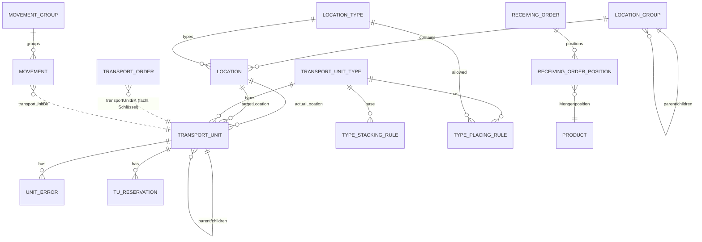

Wichtig: Zwischen den Services gibt es **keine Fremdschlüssel**. Verknüpft wird über fachliche Schlüssel (Barcode, `erpCode`, LocationId als String, Gruppenname). Jeder Service hat eine eigene Datenbank.

### 2.2 Zustände und Übergänge

**TransportOrder** (`TMS/TransportOrderState.java:26–44`, Logik `TMS/impl/state/StateManagerImpl.java:62–118`)

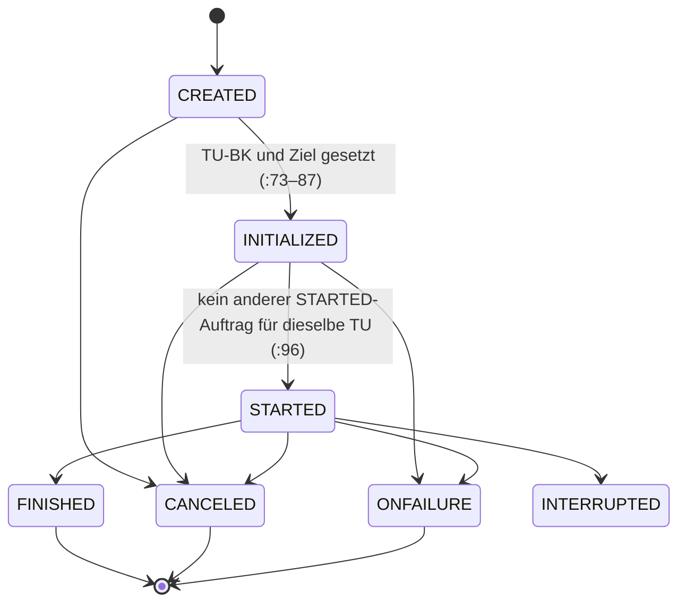
Regeln: kein Rückwärtsübergang (`:68`), Endzustände sind final (`:106`), `startDate` bzw. `endDate` werden beim Übergang gesetzt. Hinweis: `INTERRUPTED` existiert im Enum, wird aber vom StateManager nicht explizit behandelt (es fällt in den `default`-Zweig → `IllegalStateException`, wenn aus INTERRUPTED weitergeschaltet wird).

**TransportUnit-Zustand** (`CSL/transport/api/TransportUnitState`): `AVAILABLE`, `QUALITY_CHECK`, `BLOCKED` – freie Übergänge, nur über optionalen Hook `TransportUnitStateChangeApproval` prüfbar (`CSL/transport/impl/TransportUnitServiceImpl.java:463`).

**LocationGroup** (`CSL/location/LocationGroup.java`): getrennte Zustände `groupStateIn` / `groupStateOut` ∈ {`AVAILABLE`, `NOT_AVAILABLE`}. Sperren werden **rekursiv an Untergruppen vererbt**; die sperrende Gruppe wird als `stateInLocker/stateOutLocker` gemerkt, Untergruppen können eine von oben gesetzte Sperre nicht selbst aufheben (`:247`, `:290`). Statuswechsel ist nur erlaubt, wenn die Elterngruppe verfügbar ist (`:579`, `:586`).

**Location**: Flags `incomingActive` / `outgoingActive` (`isInfeedBlocked()` = `!incomingActive`, `Location.java:404`), zusätzlich `plcState` (Fehlerzustand der Anlagensteuerung) und Sperrtypen `ALLOCATION_LOCK`, `OPERATION_LOCK`, `PERMANENT_LOCK` mit Modi `IN`, `OUT`, `IN_AND_OUT`, `NONE` (`TargetController`).

**Movement** (`MVL/spi/DefaultMovementState`): `INACTIVE → ACTIVE → DONE`, `→ CANCELLED`. Startzustand/Endzustand sind über `MovementStateResolver` konfigurierbar. Typen: `MANUAL, STOCK_CHECK, INBOUND, OUTBOUND, CLEARING, EMPTIES, REPLENISHMENT, RECONCILIATION, RELOCATION, WAREHOUSE_RELOCATION`.

**ReceivingOrder / Position** (`RCL/api/OrderState`, `PositionState`)

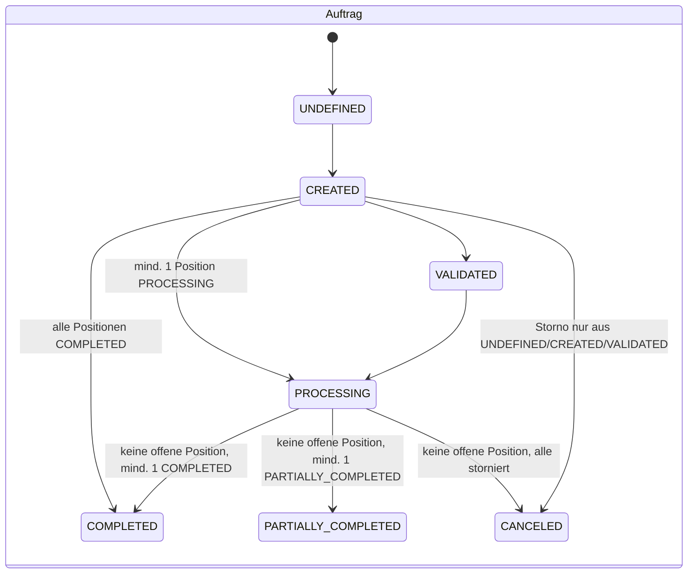
„Offen“ = Position in `CREATED` oder `PROCESSING` (`ReceivingOrder.java:263–280`). Achtung: Ein Auftrag mit einer abgeschlossenen und einer stornierten Position wird `COMPLETED`.
Der Auftragsstatus wird **aus den Positionsstatus abgeleitet** (`RCL/impl/ReceivingOrder.java:248 recalculateOrderState`), ausgelöst durch ein Event nach jedem Positionswechsel (`RCL/impl/ReceivingOrderPositionEventListener.java:52`, `@TransactionalEventListener` + `REQUIRES_NEW`). Stornieren nur in frühen Zuständen (`ReceivingOrder.java:218ff.`).

---

## 3. Phase 2 – Architekturrekonstruktion

### 3.1 Architekturdiagramm

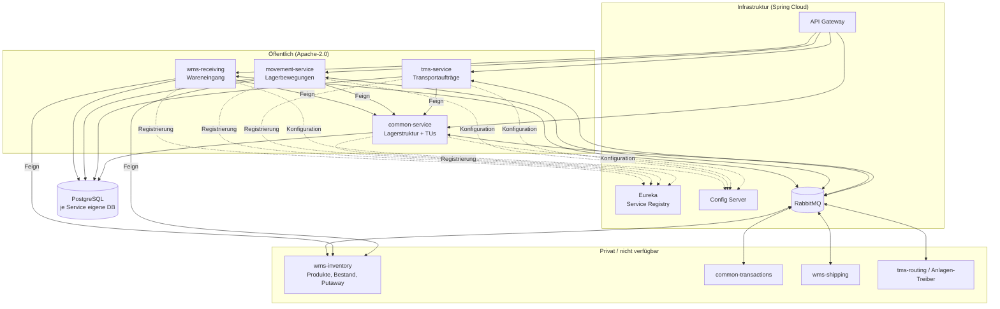

### 3.2 Service-Landkarte

| Service (Eureka-Name) | Verantwortung | Besitzt Daten | Ruft synchron auf | Hört auf (Queue → Exchange/Key) | Veröffentlicht |
|---|---|---|---|---|---|
| `common-service` | Lagerstruktur (Plätze, Gruppen, Typen), Transporteinheiten, Barcodes, Reservierungen, Mandanten | Location, LocationGroup, TU, TUT, Regeln | – | `common-loc-commands-queue` (`common.loc.commands`/`common.loc.command.in.*`), `common-tu-commands-queue` (`common.tu.commands`/`common.tu.command.in.*`), `common-registration-commands-queue`, `common-split-queue` (`shipping`/`split.event.created`) | `common.lg`: `lg.event.*`; `common.tu`: `loc.event.*`, `tu.event.*`, `tut.event.*`; `common.tu.commands`: `common.tu.command.out.removing|update-cache`; `common.tx.commands` |
| `tms-service` | Transportaufträge, Start-Steuerung, Zielumleitung | TransportOrder | `common-service` (Location/LocationGroup-API) | `tms-to-commands` (`tms.commands`/`to.*`), `tms-tu-commands-queue` (`common.tu.command.out.removing`), `tms-to-requests` (`tms.requests`/`response.state.change`) | `tms.events`: `to.event.created|started|finished|canceled`; `common.tu.command.in.remove|change-target`; `request.state.change` |
| `movement-service` | Lagerbewegungen (manuell, Einlagerung, Umlagerung, Nachschub) | Movement, MovementGroup | `common-service`, `wms-inventory` (Putaway) | `movements-command-queue` (`movements.commands`/`movement.command.create`), `movements-split-queue` | `movements`: `movement.event.created|moved|completed|cancelled`; `common.tu.command.in.changetarget`; `common.tx.command.in.create` |
| `wms-receiving` | Wareneingang: Avis, Erfassung (Menge, TU, blind), Abschluss | ReceivingOrder, Positionen, Produkt-/TU-Replikate | `common-service`, `wms-inventory` (Produkte, Packaging Units, Locations) | `receiving-products-queue` (`inventory`/`product.event.#`), `receiving-tu-queue` (`common.tu`/`tu.event.#`) | `receiving`: `receiving.event.ro.*`, `receiving.event.rop.*`; `common.tu.command.in.create|move`; `inventory.commands`/`pu.command.create` |

Belege: `*/src/main/resources/bootstrap.yml` (Abschnitt `owms.commands`, `owms.events`), `@RabbitListener` u. a. in `CSL/transport/commands/TransportUnitCommandListener.java:51`, `TMS/commands/TransportOrderCommandHandler.java:57`, `TMS/impl/removal/TransportUnitRemovalListener.java:76`, `MVL/commands/MovementCommandListener.java:52`, `RCL/transport/event/TransportUnitMessageListener.java:58`.

### 3.3 API-Übersicht (REST)

**common-service**

| Ressource | Endpunkte |
|---|---|
| `/v1/locations` | `GET` (alle, `?locationId`, `?erpCode`, `?plcCode`, `?locationGroupNames`), `GET /{pKey}`, `POST`, `PUT`, `DELETE /{pKey}`, `PATCH /{pKey}?op=change-state`, `PATCH ?locationId&op=change-state`, `POST ?erpCode&type&mode` (Sperren) |
| `/v1/location-groups` | `GET` (alle, `?name`, `?names`), `POST`, `PUT /{pKey}`, `DELETE /{pKey}`, `PATCH ?name&op=change-state`, `PATCH /{pKey}?op=change-state` |
| `/v1/location-types` | `GET` (alle, `?typeName`), `GET /{pKey}` |
| `/v1/targets/{targetBK}` | `POST ?type&mode` (ALLOCATION/OPERATION-Lock), `POST ?type=PERMANENT_LOCK&mode=lock|unlock` |
| `/v1/transport-units` | `GET` (alle, `?bk`, `?bks`, `?actualLocation`), `GET /{pKey}`, `POST ?bk`, `POST ?actualLocation&tut` (mit Barcode-Generierung), `PUT ?bk`, `PATCH ?bk&newLocation` (**Bewegen**), `DELETE /{pKey}`, `POST /synchronize`, `POST /block|/available|/quality-check ?bk`, `POST ?bk&state`, `POST /error ?bk&errorCode` |
| `/v1/transport-unit-types` | `GET` (alle, `?type`), `GET /{pKey}` |
| `/v1/accounts` | `GET` (alle, `?default`, `?identifier`, `?name`), `GET /{pKey}` |
| `/allocation/generic` | `POST` (einfache TU-Allokation, `SimpleGenericAllocator`) |

**tms-service** (`TMS/TransportationController.java`): `GET /v1/transport-orders?barcode&state`, `GET /{pKey}`, `POST` (anlegen), `POST ?barcode&target` (Kurzform), `PATCH /{pKey}`, `POST /{pKey}?state` (Statuswechsel).

**movement-service** (`MVL/MovementController`): `POST /v1/transport-units/{bk}/movements`, `GET /v1/movements` (alle, `?barcode&types&states`, `?state&types`), `PATCH /{pKey}` (bewegen), `PATCH /{pKey}/complete`, `DELETE /{pKey}` (stornieren).

**wms-receiving**: `POST /v1/receiving-orders`, `GET /v1/receiving-orders` (alle, `?orderId`), `GET /{pKey}`, `PUT|PATCH /{pKey}`, `POST /{pKey}/capture` (Erfassung gegen Auftrag), `POST /v1/capture` (Blind-Erfassung), `POST /{pKey}/complete`.

Konventionen: versionierte Pfade `/v1`, Media-Types wie `application/vnd.openwms.common.location-opt-v1+json`, HATEOAS-`/index`-Endpunkte je Ressource, `pKey` = technischer Schlüssel, `bk` = Business Key (Barcode).

### 3.4 Ereignis- und Nachrichtenübersicht

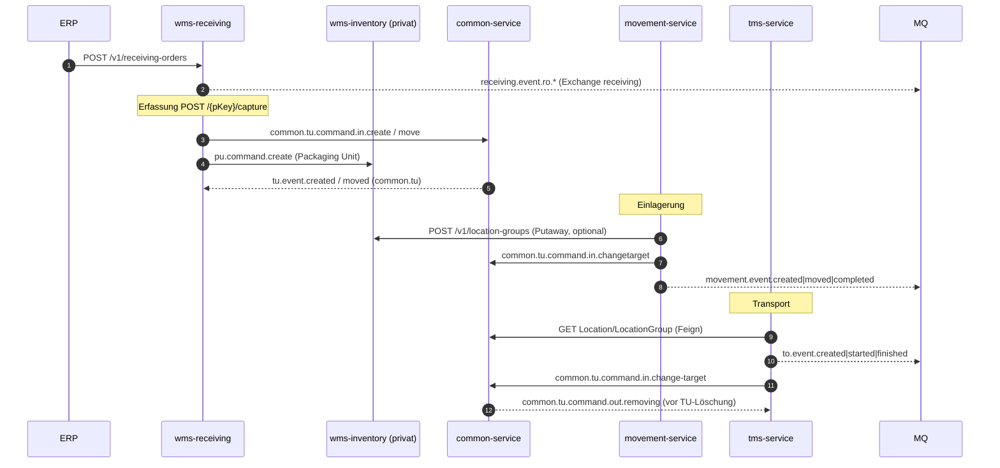

Muster im Code:
1. **Domain-Event intern → Propagator → AMQP.** Services publizieren Spring-`ApplicationEvent`s; `*EventPropagator`-Klassen senden sie nach Commit an RabbitMQ (z. B. `TMS/events/TransportOrderEventPropagator.java`, `CSL/transport/events/TransportUnitEventPropagator.java`).
2. **Kommandos per AMQP** mit Typ im Payload (`TUCommand.Type`: `REQUEST, UPDATE_CACHE, CREATE, REMOVING, REMOVE, CHANGE_TARGET, CHANGE_ACTUAL_LOCATION`), Auswertung per `switch` in `CSL/transport/commands/TransportUnitCommandHandler.java:61`. Der Routing-Key ist dadurch nur grob relevant (`common.tu.command.in.*`) – Movements nutzt `…changetarget`, TMS `…change-target`; beides kommt an.
3. **Zwei-Phasen-Löschung**: Vor dem Löschen einer TU sendet Common `common.tu.command.out.removing`; TMS prüft und lehnt ab, wenn ein STARTED-Auftrag existiert (`TMS/impl/removal/TransportUnitRemovalHandler.java:76,103,153`). Gleiches Muster für Locations über `ReplicaRegistry` (`CSL/location/impl/LocationRemovalManagerImpl.java:121,212`).
4. **Replikate**: Receiving hält lokale Kopien von Produkten und TUs, die per Events aktualisiert werden.
5. **Fehlerbehandlung**: Fehler in Listenern → `AmqpRejectAndDontRequeueException` → Dead-Letter-Exchange je Service (`dle.common`, `dle.transportation`, `dle.receiving`, `dle.inventory`).

### 3.5 Geschäftsregel-Katalog

| ID | Regel | Beleg | Im OSS durchgesetzt? |
|---|---|---|---|
| **Lagerstruktur** ||||
| L-01 | Location wird fachlich über `area/aisle/x/y/z` identifiziert; LocationId ist nach Anlage unveränderlich. | `CSL/location/LocationPK.java:45–65,93`; `LocationMapper.java:78` | ja |
| L-02 | LocationType einer Location kann nicht geändert werden, wenn er bereits gesetzt ist. | `CSL/location/Location.java:464` | ja |
| L-03 | LocationGroups sind hierarchisch; Sperre (In/Out) wird rekursiv an Kinder vererbt und kann nur von der sperrenden Gruppe aufgehoben werden. | `CSL/location/LocationGroup.java:247,290` | ja |
| L-04 | Statuswechsel einer Gruppe nur, wenn Elterngruppe verfügbar. | `LocationGroup.java:579,586` | ja |
| L-05 | Location darf nicht gelöscht werden, solange TUs darauf stehen oder ein anderer Service widerspricht. | `CSL/location/impl/LocationRemovalManagerImpl.java:121,128,212` | ja |
| L-06 | Max. Anzahl TUs pro Platz (`noMaxTransportUnits`), Maximalgewicht. | `Location.java:114,120` | **nein** (nur gespeichert) |
| **Transporteinheiten** ||||
| T-01 | Barcode ist fachlicher Schlüssel; Barcodes können generiert werden (`NextBarcode`). | `CSL/transport/barcode/*` | ja |
| T-02 | Bewegen auf den aktuellen Platz ist ein No-Op. | `CSL/transport/impl/TransportUnitServiceImpl.java:243` | ja |
| T-03 | Bewegen und Statuswechsel sind über `TransportUnitMoveApproval` / `TransportUnitStateChangeApproval` prüfbar. | `TransportUnitServiceImpl.java:230–240,463` | **nur Hook, keine Implementierung** |
| T-04 | Stapel- und Platzierungsregeln je TU-Typ. | `TransportUnitType.java:103,108`, `TypeStackingRule`, `TypePlacingRule` | **nein** (nur gespeichert) |
| T-05 | TU darf nicht gelöscht werden, wenn ein STARTED-Transportauftrag existiert; INITIALIZED-Aufträge werden storniert. | `TMS/impl/removal/TransportUnitRemovalHandler.java:103,153` | ja (konfigurierbar) |
| **Transportaufträge** ||||
| O-01 | Initialisierung nur mit TU-Barcode und Ziel (Platz oder Gruppe). | `TMS/impl/state/StateManagerImpl.java:73–87` | ja |
| O-02 | Pro TU höchstens ein STARTED-Auftrag. | `StateManagerImpl.java:96` | ja |
| O-03 | Keine Rückwärtsübergänge, Endzustände final. | `StateManagerImpl.java:68,106` | ja |
| O-04 | Start nur, wenn Zielgruppe bzw. Zielplatz nicht für Einlagerung gesperrt ist. | `TMS/impl/state/Starter.java:128,131,139` | ja |
| O-05 | Initialisierungsreihenfolge: Priorität, dann Anlagereihenfolge (pk). | `TMS/impl/state/TransportStartComparator.java:45`, `Initializer.java:68` | ja |
| O-06 | Nach Abschluss wird der nächste INITIALIZED-Auftrag der TU gestartet. | `Starter.java:86` | ja |
| O-07 | Zielumleitung über Voter-Kette (Platz/Gruppe verfügbar?). | `TMS/impl/redirection/TargetRedirector.java:49` | ja |
| **Lagerbewegungen** ||||
| M-01 | Movement ohne Ziel wird abgelehnt; Typ wird ggf. per Resolver bestimmt. | `MVL/impl/handler/AbstractMovementHandler.java:52`; `MVL/impl/MovementServiceImpl.java:186,189` | ja |
| M-02 | Abgeschlossenes Movement kann nicht mehr bewegt werden. | `MovementServiceImpl.java:233` | ja |
| M-03 | Abschluss/Storno nur aus „niedrigeren“ Zuständen (Ordinal-Vergleich). | `MovementServiceImpl.java:261,287` | ja (fragil, s. 6.4) |
| M-04 | Einlagerziel per Putaway-Strategie (externer, privater Dienst). | `MVL/impl/PutawayAdapter.java:55,66` | optional |
| **Wareneingang** ||||
| R-01 | `orderId` eindeutig. | `RCL/impl/ReceivingServiceImpl.java:89` | ja |
| R-02 | Mengenerfassung: passende offene Position mit gleichem Produkt **und gleicher Einheit** und ausreichender Restmenge; sonst erste offene Position nur bei `overbookingAllowed`. | `RCL/impl/QuantityCaptureRequestCapturer.java:100,104–105,110,117` | ja |
| R-03 | Position wird COMPLETED, sobald `received ≥ expected`, sonst PROCESSING. | `QuantityCaptureRequestCapturer.java:128–131` | ja |
| R-04 | TU-Erfassung erfordert TU-Typ; erfüllt eine offene TU-Position und bucht die TU auf den Erfassungsplatz. | `RCL/impl/TUCaptureRequestCapturer.java:81,105,109,111` | ja |
| R-05 | Auftragsstatus wird aus Positionsstatus berechnet. | `RCL/impl/ReceivingOrder.java:248–263` | ja |
| R-06 | Storno nur in UNDEFINED/CREATED/VALIDATED. | `ReceivingOrder.java:218ff.` | ja |
| R-07 | Manueller Statuswechsel nur nach COMPLETED. | `ReceivingServiceImpl.java:238` | ja |

### 3.6 Abhängigkeitsdiagramm (Build-Zeit)

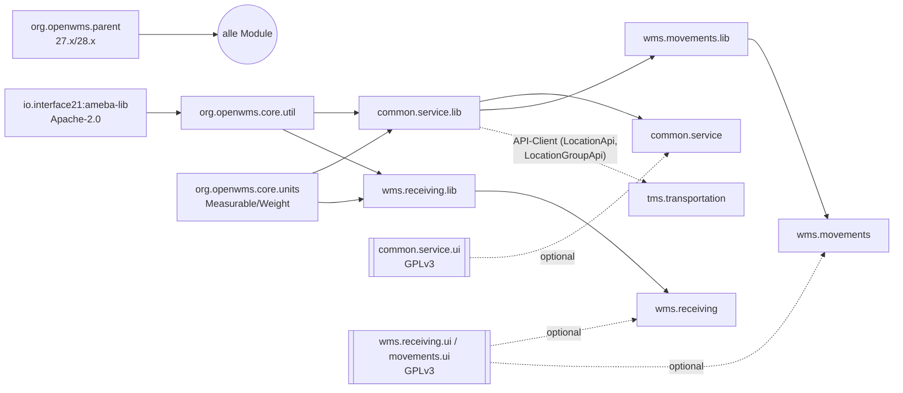

Hinweis: Receiving- und Movements-Lib duplizieren einzelne Klassen aus Common (z. B. `org/openwms/common/transport/api/commands/*`, `Barcode`), statt sie als Abhängigkeit zu beziehen.

### 3.7 TMS Routing (Materialflusssteuerung)

Analysiert (alle öffentlich, Apache-2.0, Parent 27.7.1): `org.openwms.tms.routing` (Starter, nur 1 Java-Datei + BPMN-Beispiele), `org.openwms.tms.routing.lib` (Logik, 56 Klassen, 7 Tests, Stand 2026-02-19), `org.openwms.tms.routing.osip` (Telegramm-Handler, 31 Klassen, keine Tests), `org.openwms.core.process.execution` (Workflow-Ausführung). Abkürzungen: `RTL` = `org.openwms.tms.routing.lib/src/main/java/org/openwms/tms/routing`, `OSP` = `org.openwms.tms.routing.osip/src/main/java/org/openwms/common/comm/osip`.

**Zweck:** Steuert TUs in automatischen Anlagen (Fördertechnik, Regalbediengeräte). Eine Anlage (SPS) meldet per Telegramm „TU X steht an Platz Y“, das Routing entscheidet, was zu tun ist, und antwortet mit dem nächsten Ziel. **Wichtig:** Es ist **keine Wegsuche in einem Graphen**, sondern eine Kombination aus hierarchischen Nachschlagetabellen und konfigurierbaren BPMN-Workflows.

#### Datenmodell

| Entität | Tabelle | Felder | Bedeutung |
|---|---|---|---|
| `RouteImpl` | `TMS_RSRV_ROUTE` | `routeId`, `sourceLocation`, `targetLocation`, `sourceLocationGroupName`, `targetLocationGroupName`, `enabled` (`RTL/RouteImpl.java:44–58`) | Route von Quelle (Platz oder Gruppe) nach Ziel (Platz oder Gruppe); Sonderrouten `_DEFAULT` und `_NO_ROUTE` |
| `RouteDetails` | `TMS_RSRV_ROUTE_DETAILS` | `route`, `pos`, `source`, `next` (`RTL/routes/RouteDetails.java:44–57`) | Nächster-Schritt-Tabelle: „steht die TU an `source`, schicke sie zu `next`“ |
| `Action` | `TMS_RSRV_ACTION` | `route`, `actionType`, `locationKey`, `locationGroupName`, `programKey`, `flexField1–5`, `enabled` (`RTL/Action.java:45–63`) | Zuordnung (Telegrammtyp + Route + Ort) → auszuführender Workflow mit Parametern |
| `LocationEO` | `TMS_RSRV_LOCATION` | `locationId`, `locationGroupName`, `markForDeletion` | lokales Replikat der Plätze aus Common |

#### Ablauf einer Anfrage

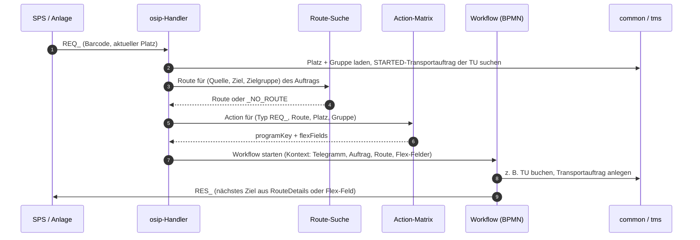

Beleg: `OSP/ItemMessageHandler.java:61–93` – ohne STARTED-Auftrag oder ohne passende Route wird `_NO_ROUTE` verwendet (`:79`, `:86–88`, Ausnahme bewusst ignoriert).

#### Route-Suche (`RTL/routes/impl/RouteSearchAlgorithmImpl.java:71ff.`, Profil `!SIMPLE`)

Vom Spezifischen zum Allgemeinen, nur `enabled`-Routen:
1. Quellplatz → Zielplatz
2. Quellplatz → Zielgruppe
3. Quellplatz → Gruppe des Zielplatzes, dann deren Elterngruppen
4. Gruppe des Quellplatzes → Zielplatz, dann Elterngruppen der Quelle
5. Gruppe der Quelle → Zielgruppe, jeweils Eltern auf beiden Seiten
6. keine Route → `NoRouteException`

Alternative `ExplicitRouteSearch` (Profil `SIMPLE`): nur exakte Treffer Platz→Platz bzw. Platz→Gruppe.

#### Action-Matrix (`RTL/spi/ActivitiMatrix.java:71–118`, `:121`)

Suche nach (Telegrammtyp, Route, Platz, Gruppe), wieder vom Spezifischen zum Allgemeinen: Platz + Route → Platz + `_DEFAULT`-Route → Gruppe des Platzes und deren Elterngruppen → übergebene Gruppe und Eltern → dieselbe Suche mit `_DEFAULT`-Route. Ergebnis ist ein `programKey` (BPMN-Prozess-ID) plus fünf freie Parameter (`flexField1–5`).

#### Nächster Schritt (`RTL/routes/impl/RouteServiceImpl.java:89–115`)

`sendToNextLocation()` sucht in `RouteDetails` der aktuellen Route den Eintrag mit `source = aktueller Platz` und sendet dessen `next`; Rückfall auf die `_DEFAULT`-Route. `changeRoute(routeId)` erlaubt Workflows, die Route zu wechseln.

#### Workflows und Telegramme

- Workflows sind BPMN-Dateien, deren Service-Tasks Spring-Beans per Ausdruck aufrufen, z. B. `#{transportUnitApi.createTU(in.msg.barcode, in.msg.actualLocation, "PALLET", false)}` und `#{responder.sendToLocation(in.msg.flexField1)}` (`org.openwms.tms.routing/src/main/resources/flowable/processes/CP001.bpmn20.xml`). Ziel laut README: Materialfluss ändern **ohne Neukompilierung und ohne Deployment**.
- Unterstützte Telegramme (OSIP): `REQ_` (Zielanfrage), `RES_` (Antwort), `LOCU` (Platzstatus), `SYSU` (Systemstatus, z. B. Gruppenstatus aus Fehlercode – `CP003`), `UPD_` (Bewegungsmeldung), `ERR_` (Fehler). Eingang per AMQP oder REST (`/req`, `/locu`, `/sysu`, `/upd`).
- Zusätzlich zeitgesteuerte Workflows (`org.openwms.core.process.execution/.../timing/TimeTriggeredWorkflowExecutor.java`).
- REST-Verwaltung: `/routes`, `/actions`, `/workflows` (`RTL/ui/*Resource.java`).

#### Schwachstellen

| # | Stelle | Problem |
|---|---|---|
| R1 | `RTL/ui/RouteResource.java:70,76,83` und `RTL/ui/ActionResource.java:69,75,82` | `@CacheEvict("routes")`/`("actions")` **ohne `allEntries = true`**: Der Cache-Schlüssel der Suche ist (Quelle, Ziel, Gruppe) bzw. (Typ, Route, Platz, Gruppe), gelöscht wird aber unter `pKey`/VO. Geänderte Routen und Actions wirken erst nach Neustart bzw. Cache-Ablauf. |
| R2 | `RTL/routes/impl/RouteSearchAlgorithmImpl.java:57,72–73` | Alle LocationGroups werden **einmalig** in ein Feld geladen, die Platz→Gruppe-Zuordnung wird nie geleert. Neue oder umgehängte Gruppen führen bis zum Neustart zu `NotFoundException` bzw. falschen Routen. |
| R3 | README vs. `org.openwms.core.process.execution` | README nennt Flowable als Standard, die Ausführungsbibliothek enthält aber nur Executoren für Camunda (`!FLOWABLE && !ACTIVITI`) und Activiti; ein Flowable-Executor fehlt im öffentlichen Code. |
| R4 | `OSP/ItemMessageHandler.java:86–88` | `NoRouteException` wird still verschluckt – fehlende Routenkonfiguration fällt nur über `_NO_ROUTE`-Actions auf. |
| R5 | `org.openwms.tms.routing.osip` | keine Tests für die Telegramm-Verarbeitung. |

---

## 4. Eingesetzte Werkzeuge (REA)

REA 6.9.0 ist in dieser Umgebung verfügbar (u. a. `inspect_artifact`, `binary_overview`, `analyze_javascript_application`, `inspect_managed_artifact`). Für diese Analyse wurde **bewusst kein REA-Werkzeug eingesetzt**: Der gesamte relevante Code liegt als lesbarer Java-Quelltext unter Apache-2.0 vor; Dekompilierung oder Binäranalyse hätte keinen zusätzlichen Erkenntnisgewinn gebracht. Sinnvoller REA-Einsatz später: Analyse der veröffentlichten JARs/Docker-Images auf Maven Central bzw. Docker Hub, falls Stände ohne Quellcode verglichen werden müssen – ohne Ausführung unbekannter Binärdateien. Private Komponenten (Inventory, Putaway) werden **nicht** per Reverse Engineering aus Images rekonstruiert; ihre Funktion wird aus den öffentlichen Schnittstellen (Feign-Clients in `RCL/spi/wms/inventory/*`, `MVL/spi/common/putaway/PutawayApi.java`) abgeleitet und eigenständig entworfen.

---

## 5. Phase 3 – Rebuild-Plan

### 5.1 Architekturentscheidung

| Thema | OpenWMS | Empfehlung Rebuild | Begründung |
|---|---|---|---|
| Sprache/Plattform | Java 21/25, Spring Boot 3.4–4.1 | **TypeScript (strict), Node.js LTS, NestJS** | Teamerfahrung; NestJS bietet Module + Dependency Injection ähnlich Spring |
| Schnitt | 4+ Microservices + Eureka, Config, Gateway, Bus | **Modularer Monolith**, ein NestJS-Modul je Bounded Context; Grenzen per `dependency-cruiser` geprüft | Gleiche fachliche Grenzen ohne Betriebsaufwand; spätere Auftrennung möglich |
| Persistenz | JPA, `ddl-auto: create/update` | PostgreSQL + **MikroORM** (Unit of Work, Optimistic Locking per Versionsspalte) + versionierte **Migrationen** | Am nächsten am JPA-Modell, reproduzierbares Schema |
| Interne Kommunikation | RabbitMQ-Events + Feign | In-Process-Domain-Events + **Transactional Outbox** (Tabelle, im selben Commit geschrieben) | Keine verlorenen Events bei Fehlern |
| Externe Events | RabbitMQ | **MQTT** (Mosquitto) aus der Outbox, Topics `wms/<modul>/<event>` | Nativ in Node-RED und in der Lager-/Anlagenwelt üblich |
| Validierung | Jakarta Validation | **Zod** an allen Systemgrenzen, daraus OpenAPI | Typen existieren zur Laufzeit nicht |
| Mengen/Gewichte | `org.openwms.core.units` (Measurable) | eigener `Quantity`-Wertetyp auf **`decimal.js`**, DB-Spalten `NUMERIC` | **Nie `number` für Mengen** (Float-Fehler) |
| Fachliche Schlüssel | Klassen (`Barcode`, `LocationPK`) | **Branded Types** (`Barcode`, `LocationId`, `ErpCode`) | Verwechslungsschutz bei strukturellen Typen |
| Regeln | optionale SPI-Hooks ohne Implementierung | Regeln als explizite Domain-Policies **mit** Default-Implementierung | Schließt die größte fachliche Lücke |
| Zustandsautomaten | `switch`/`ordinal()` verteilt | je Aggregat eine Übergangstabelle (erlaubte Übergänge explizit) | testbar, keine Ordinal-Abhängigkeit |
| Tests | 72 Testklassen, ungleich verteilt | **Vitest** (Unit), Testcontainers (PostgreSQL, Mosquitto), Supertest (API) | |
| Repo-Struktur | ein Repo je Service | **pnpm-Monorepo**: `apps/api`, `apps/web` (später), `packages/api-client` (aus OpenAPI generiert), `packages/node-red-nodes` | gemeinsame Typen für Kern, UI und Node-RED |

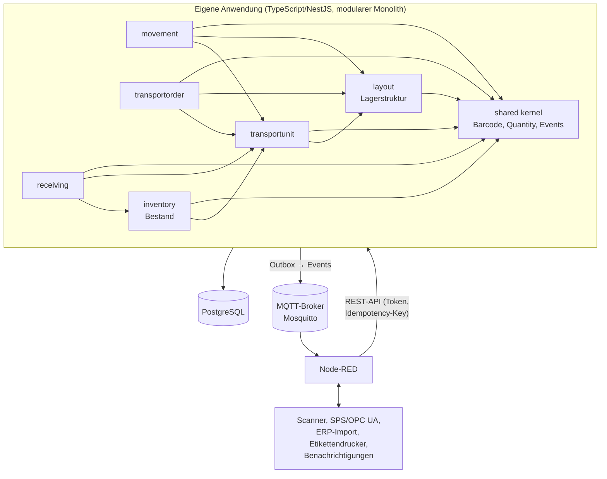

### 5.1a Rolle von Node-RED

| Node-RED **ja** | Node-RED **nein** |
|---|---|
| Anlagen- und Geräteanbindung: SPS über OPC UA/Modbus, Lichtschranken, Waagen, Barcode-Scanner, Pick-by-Light | Zustandsautomaten (TU, Movement, Transportauftrag, Wareneingang) |
| Schnittstellen: ERP-Avise per CSV/REST/E-Mail einlesen und als Wareneingang anlegen | Kapazitäts-, Gewichts-, Stapel- und Platzierungsregeln |
| Reaktionen auf Events: Etikett drucken bei `tu.created`, Meldung bei `transport-order.failed` | Bestandsbuchungen und -berechnungen |
| Leitstands-Dashboards, Prototypen neuer Abläufe | direkter Datenbankzugriff |

Technische Leitplanken:
1. **Nur über die öffentliche API schreiben.** Node-RED bekommt einen eigenen API-Token mit eingeschränkten Rechten. So greifen alle Regeln im Kern auch für Node-RED.
2. **Idempotenz:** Schreibende Aufrufe tragen einen `Idempotency-Key`, damit wiederholte Flows (Retry, doppelter Scan) keine Doppelbuchungen erzeugen.
3. **Events über MQTT** mit QoS 1, eindeutiger Event-ID und Versionsfeld. Konsumenten müssen Duplikate tolerieren.
4. **Eigene Node-RED-Nodes** als npm-Paket (`packages/node-red-nodes`) mit Config-Node (URL + Token) und fachlichen Nodes wie „TU bewegen“, „Wareneingang erfassen“, „Transportauftrag anlegen“, „WMS-Event“. Die Nodes nutzen den generierten, typisierten API-Client.
5. **Flows versionieren:** Node-RED-Projects-Funktion (Git); produktive Flows im Monorepo unter `flows/`.
6. **Absicherung:** `adminAuth` aktiv, Node-RED nicht öffentlich erreichbar, Zugangsdaten nur in Node-RED-Credentials, nicht in Flows.

### 5.1b Strategie- und Regelwerk (Einlagerung, Auslagerung, Routing, …)

**Ziel:** Lagerstrategien sind konfigurierbar, ohne den Kern umzuprogrammieren, bleiben aber typsicher, testbar und nachvollziehbar.

**Vorbild in OpenWMS:** nur Ansätze – Putaway extern und privat (`MVL/impl/PutawayAdapter.java:66`), Zielumleitung per Voter-Kette (`TMS/impl/redirection/TargetRedirector.java:49`), feste Startreihenfolge (`TMS/impl/state/TransportStartComparator.java:45`), Typauflösung (`MVL/spi/MovementTypeResolver`), einfache Allokation (`CSL/transport/allocation/spi/SimpleGenericAllocator.java`).

#### Entscheidungspunkte

| Entscheidungspunkt | Frage | Mitgelieferte Strategien (Beispiele) | Ab Schritt |
|---|---|---|---|
| **Einlagerung (Putaway)** | Auf welchen Platz kommt diese TU? | erster freier Platz (nach `sortOrder`), nächster Platz zum Einlagerpunkt, ABC-Zonen, Festplatz je Produkt, Zusammenlagern gleicher Produkte/Chargen, gleichmäßige Gassenverteilung | 3 |
| **Auslagerung / Bestandsauswahl** | Welcher Bestand wird für einen Bedarf genommen? | FIFO, FEFO (Verfallsdatum), LIFO, Anbruch zuerst, ganze TU bevorzugen, kürzester Weg, Mindestrestlaufzeit | 8 |
| **Routing** | Über welche Stationen/Fördertechnik fährt die TU zum Ziel? | **tabellenbasiert wie OpenWMS** (Route-Suche über Platz-/Gruppenhierarchie + Nächster-Schritt-Tabelle, Kap. 3.7); später optional kürzester Weg im Wegegraph, Umleitung bei gesperrten Abschnitten, Lastverteilung auf parallele Strecken | 5 |
| **Anlagenreaktion (Action)** | Was passiert, wenn die Anlage „TU X an Platz Y“ meldet? | Action-Matrix (Telegrammtyp + Route + Platz/Gruppe → Programm + Parameter) | 5 |
| **Zielumleitung** | Ziel gesperrt oder voll – was jetzt? | Ersatzplatz in gleicher Gruppe, Rückfall auf Gruppe, Klärplatz | 5 |
| **Priorisierung** | In welcher Reihenfolge werden Aufträge gestartet? | Priorität + Anlagezeit (wie OpenWMS), Fälligkeit, Wellen | 5 |
| **Nachschub** | Wann und wie viel wird nachgefüllt? | Min/Max je Festplatz, bedarfsgesteuert | 6 |
| **Leergutbehandlung** | Wohin mit leeren TUs? | Leergutpuffer, Stapelplatz je TU-Typ | 3 |

#### Aufbau (drei Ebenen)

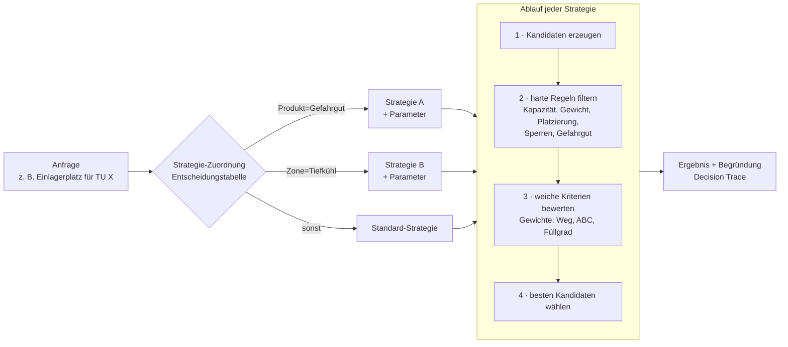

1. **Strategien als Code (TypeScript-Plugins).** Jede Strategie implementiert eine Schnittstelle je Entscheidungspunkt, z. B. `PutawayStrategy.decide(ctx): Decision<Location>`, und deklariert ihre **Parameter als Zod-Schema** (z. B. `{ zone: string, preferLowerLevels: boolean }`). Neue Strategien = neues Modul, ohne Änderung des Kerns.
2. **Konfiguration in der Datenbank.** Welche Strategie mit welchen Parametern gilt, steht in einer **Entscheidungstabelle**: Bedingungen (Produktklasse, ABC-Klasse, TU-Typ, Zone, Mandant, Auftragsart, Uhrzeit) → Strategie + Parameter, ausgewertet nach Priorität, mit Rückfallzeile. Bedingungen sind ein **eigenes, typisiertes JSON-Modell** (Vergleiche, `in`, `und/oder`) – kein frei ausführbarer Code, damit keine Sicherheitslücke und keine untestbare Logik entsteht.
3. **Harte Regeln vs. weiche Kriterien.** Harte Regeln (Kapazität, Gewicht, Stapel-/Platzierungsregeln aus Kap. 3.5, Sperren) gelten **immer und für alle Strategien** – eine Strategie kann sie nicht abschalten. Weiche Kriterien sind gewichtete Bewertungen und frei konfigurierbar.

#### Querschnittsanforderungen

| Anforderung | Umsetzung |
|---|---|
| **Nachvollziehbarkeit** | Jede Entscheidung liefert einen *Decision Trace*: gewählte Strategie, Regelzeile, Kandidaten, Ausschlussgründe, Punktwerte. Wird gespeichert und ist per API abrufbar („Warum kam die Palette auf 01-03-12?“) |
| **Simulation** | Endpunkt `POST /v1/strategies/{punkt}/simulate`: Entscheidung berechnen, ohne zu buchen – zum Testen neuer Regeln |
| **Versionierung** | Regelsätze mit Version, Gültigkeitszeitraum und Audit (wer hat wann was geändert); Aktivierung erst nach Simulation |
| **Gleichzeitigkeit** | Gewählter Platz wird im selben Commit reserviert (Optimistic Locking), damit zwei TUs nicht denselben Platz bekommen |
| **Leistung** | Kandidaten per SQL vorfiltern (Zone, Typ, frei), erst danach im Code bewerten |
| **Tests** | Jede Strategie mit Tabellen-Tests (Lagerzustand → erwarteter Platz) |

#### Rolle von Node-RED bei Strategien

- **Standard:** Strategien laufen im Kern. Node-RED reagiert nur auf Ergebnisse (z. B. Fahrauftrag an die SPS senden).
- **Optional – externe Strategie:** Für Sonderfälle kann eine Strategie `external-http` einen Node-RED-Flow (oder ein anderes System) per HTTP fragen. Pflicht: kurzes Timeout, **Ergebnis wird gegen die harten Regeln geprüft**, bei Fehler oder Zeitüberschreitung greift die Rückfallstrategie. So kann Node-RED Regeln ergänzen, aber keine verletzen.
- **Nicht:** Regelkonfiguration in Node-RED pflegen – die gehört versioniert in den Kern.

### 5.1c Materialfluss-Modul (Ersatz für TMS-Routing)

Übernommen wird das **Prinzip** aus Kap. 3.7, nicht die Umsetzung:

| OpenWMS | Rebuild |
|---|---|
| OSIP-Telegramme über AMQP/REST | **Geräte-Ereignisse** mit eigenem, versioniertem Schema (`request`, `arrived`, `location-status`, `system-status`, `error`), Eingang per MQTT oder REST. Node-RED übersetzt das jeweilige Anlagenprotokoll (OSIP, OPC UA, Modbus, herstellerspezifisch) in diese Ereignisse. |
| Route-Suche mit Hierarchie-Fallback | gleiche Suchreihenfolge, aber **eine** SQL-Abfrage über die Gruppen-Hierarchie (rekursive CTE) statt vieler Einzelabfragen; kein langlebiger Speicher-Cache (Schwachstelle R2) |
| `RouteDetails` (source → next) | `route_step` mit gleicher Bedeutung, zusätzlich `enabled` und optionale Bedingung (z. B. nur bei TU-Typ X) |
| Action-Matrix → BPMN `programKey` + `flexField1–5` | `flow_action`: (Ereignistyp, Route, Platz/Gruppe) → **Programm** + Parameter als typisiertes JSON (Zod-Schema je Programm) statt fünf Freitextfeldern |
| BPMN-Workflow (Flowable/Camunda/Activiti) | **Programm-Typen:** (a) eingebaute TypeScript-Handler (TU buchen, Transportauftrag anlegen, nächstes Ziel senden, Gruppe sperren); (b) **Node-RED-Flow**: Kern veröffentlicht `wms/flow/program/<programKey>` mit Kontext, Node-RED führt aus und antwortet über die API |
| Cache-Invalidierung per Schlüssel (fehlerhaft, R1) | Konfigurationsänderungen erhöhen eine Versionsnummer; Caches werden komplett verworfen |
| `NoRouteException` still ignoriert (R4) | „keine Route“ ist ein eigenes Ergebnis im Decision Trace und löst ein Ereignis aus |

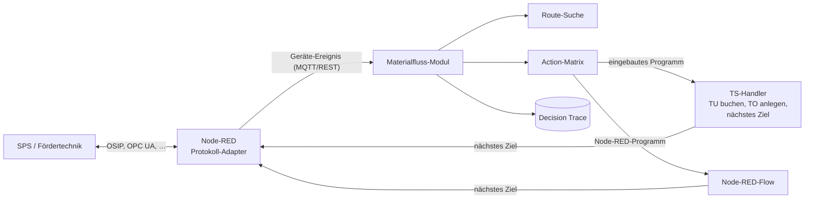

Damit erfüllt Node-RED die Rolle, für die OpenWMS BPMN einsetzt – Materialfluss ändern ohne Neukompilierung –, während Zustände und Regeln im Kern bleiben (Leitplanken aus 5.1a). Eine BPMN-Engine ist im ersten Ausbau nicht nötig.

### 5.1d Teststrategie mit Node-RED

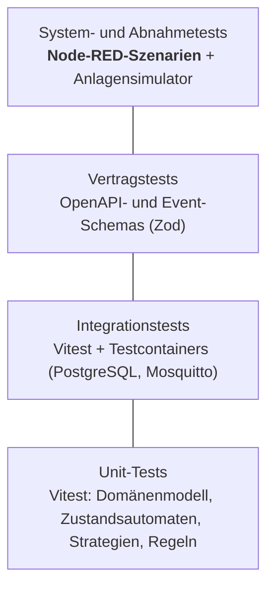

| Ebene | Werkzeug | Inhalt | Läuft |
|---|---|---|---|
| Unit | Vitest | Zustandsübergänge, harte Regeln, Strategien als Tabellen-Tests | bei jedem Commit, Sekunden |
| Integration | Vitest + Testcontainers | Repositories, Migrationen, Outbox → MQTT, REST-Endpunkte | bei jedem Commit, Minuten |
| Vertrag | Vitest | Events und API gegen die Zod-/OpenAPI-Schemas; dieselben Schemas nutzt Node-RED | bei jedem Commit |
| Eigene Node-RED-Nodes | `node-red-node-test-helper` | Nodes aus `packages/node-red-nodes` isoliert testen | bei jedem Commit |
| **System/Abnahme** | **Node-RED** (Szenario-Flows + Simulator) | fachliche Ende-zu-Ende-Abläufe gegen die laufende Anwendung | in der CI nach dem Build und nachts; Last-/Dauertests manuell |

#### Bausteine in Node-RED

1. **Anlagensimulator** (`flows/simulator/`): bildet Fördertechnik, Regalbediengerät und Scanner nach. Reagiert auf „nächstes Ziel“ mit konfigurierbarer Fahrzeit und meldet `arrived`; kann Störungen einspeisen (`error`, Platz gesperrt, Zeitüberschreitung). Das Layout (Plätze, Strecken, Fahrzeiten) kommt aus einer Konfigurationsdatei, nicht aus dem Flow.
2. **Szenario-Flows** (`flows/scenarios/`): je Szenario ein Flow nach dem Muster *Vorbereiten → Auslösen → Warten auf Ereignis → Prüfen → Ergebnis melden*. Beispiele:
   - Wareneingang: Avis anlegen, Menge erfassen, Überbuchung ohne Freigabe wird abgelehnt (R-02).
   - Einlagerung: TU erfassen, Einlagerstrategie wählt Platz, Simulator fährt hin, TU steht am Ziel, Decision Trace vorhanden.
   - Transportauftrag: zweiter Start für dieselbe TU wird abgelehnt (O-02), gesperrtes Ziel verhindert Start (O-04).
   - Materialfluss: Anfrage an Station ohne Route erzeugt ein „keine Route“-Ereignis (R4).
   - Kapazität: Platz voll → Einlagerung wählt anderen Platz (L-06).
3. **Gemeinsame Test-Nodes** (Teil von Schritt 7): „Szenario starten“, „auf WMS-Ereignis warten (mit Timeout)“, „prüfen“ (Feldvergleich), „Ergebnis melden“.

#### Einbindung in die CI

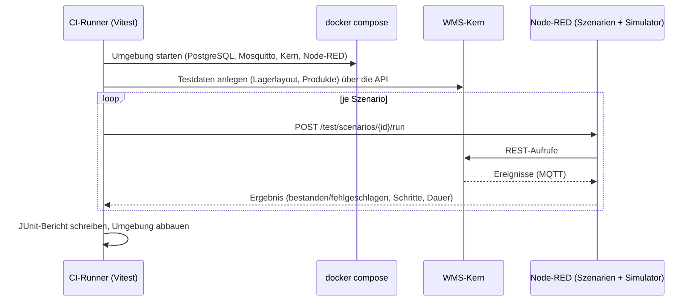

Ein schlanker Vitest-Runner steuert die Szenarien. So erscheinen Node-RED-Tests als normale Testfälle mit JUnit-Bericht in der CI.

#### Regeln, damit die Tests verlässlich bleiben

| Regel | Umsetzung |
|---|---|
| **Unabhängige Szenarien** | Jedes Szenario erzeugt eigene Testdaten mit eindeutigem Präfix (z. B. Barcode `T-<lauf>-<nr>`), keine gemeinsamen Datensätze |
| **Kein festes Warten** | Auf Ereignisse warten mit Timeout statt `delay`-Nodes; Timeouts zentral konfigurierbar |
| **Steuerbare Zeit** | Simulator-Fahrzeiten im Testlauf verkürzt; Uhrzeit-abhängige Regeln mit injizierbarer Uhr im Kern |
| **Nur über die öffentliche API** | Szenarien nutzen dieselben Schnittstellen wie produktive Flows; kein Datenbankzugriff |
| **Test-Endpunkte nur im Testprofil** | z. B. Daten zurücksetzen oder Uhr setzen – im Produktivprofil nicht vorhanden |
| **Flows versioniert** | Szenarien und Simulator im Monorepo unter `flows/`, Änderungen per Pull Request |
| **Klare Fehlermeldung** | Ergebnis enthält Szenario, Schritt, erwarteten und tatsächlichen Wert sowie die Korrelations-ID des Ereignisses |

### 5.2 Eigenbau oder Wiederverwendung

| Baustein | Entscheidung | Begründung |
|---|---|---|
| Fachkonzepte, Zustandsautomaten, API-Schnitt | **Nachbauen** (eigener Code, OpenWMS als Referenz) | Konzepte sind nicht urheberrechtlich geschützt; eigener Code vermeidet Übernahme der gefundenen Fehler und der Infrastrukturkopplung |
| Einzelne Klassen aus `common.service.lib`, `tms.transportation` | **Zulässig**, wenn nötig | Apache-2.0: Lizenztext beilegen, Copyright-Header behalten, Änderungen kennzeichnen (§ 4). Empfehlung: nur punktuell, z. B. Barcode-Generierung |
| `org.openwms.core.units`, `ameba-lib` | **entfällt** | Java-Bibliotheken, in TypeScript nicht nutzbar; Ersatz: eigener `Quantity`-Typ auf `decimal.js` |
| Direkte Portierung von OpenWMS-Code nach TypeScript | **zulässig, aber sparsam** | Eine Übersetzung gilt als abgeleitetes Werk: Apache-2.0-Lizenz beilegen, Herkunft und Änderungen kennzeichnen. Fachlich nachbauen ist einfacher und vermeidet die Fehler aus 5.4 |
| Bestandsführung, Produkte, Packaging Units | **Eigenbau** | Original privat |
| Putaway-/Einlagerstrategie | **Eigenbau** (einfache Strategie: erster freier Platz in Zielgruppe nach `sortOrder`) | Original privat, GPLv3 |
| UI-Module (`*.ui`) | **nicht verwenden** | GPLv3 |
| Name/Logo „OpenWMS“ | **nicht verwenden** | Markenrecht, Apache-2.0 § 6 |
| Demodaten (`import-DEMO.sql`) | nur als Strukturvorbild; eigene synthetische Testdaten | keine realen Kundendaten |
| Standard-OSS: NestJS, MikroORM, Zod, decimal.js, Vitest, Testcontainers, PostgreSQL, Eclipse Mosquitto, Node-RED | **verwenden** | MIT, Apache-2.0, EPL-2.0/EDL-1.0 (Mosquitto, nur als separater Dienst betrieben) bzw. PostgreSQL-Lizenz – alle mit eigener Nutzung vereinbar; Lizenzen beim Aufsetzen nochmals prüfen |

### 5.3 Priorisierter Implementierungsplan

**Umsetzungsstand:** Schritt 0 ✅ (Grundgerüst) · Schritt 1 ✅ (Lagerstruktur) · Schritt 2 ✅ (Transporteinheiten) · Schritt 2a ✅ (Strategie-Kern, Einlagerstrategien) · Schritt 3 ✅ (Lagerbewegungen) – Details in [entwicklung.md](entwicklung.md).

Reihenfolge wie gewünscht. Eine fachliche Abhängigkeit ist zu beachten: Der Wareneingang (4) bucht Bestand. Deshalb wird in Schritt 4 ein **minimales Produkt- und Bestandsmodell** angelegt, das in Schritt 6 zur vollständigen Bestandsführung ausgebaut wird.

| Prio | Schritt | Umfang | Fachliche Regeln (aus Katalog) | Abnahmekriterien |
|---|---|---|---|---|
| 0 | **Grundgerüst** | pnpm-Monorepo, TypeScript strict, NestJS, MikroORM + Migrationen, Zod → OpenAPI, Outbox + MQTT-Publisher, Vitest, Testcontainers, CI; `docker compose` mit PostgreSQL, Mosquitto, Node-RED; **Test-Gerüst nach 5.1d** (Vitest-Runner für Node-RED-Szenarien, JUnit-Bericht, Testprofil) | – | `pnpm test` grün, Modulgrenzen geprüft, Test-Event kommt in Node-RED an, ein Beispiel-Szenario läuft in der CI |
| 1 | **Lagerstruktur** | `LocationType`, `LocationGroup` (Hierarchie), `Location` (area/aisle/x/y/z, erpCode, plcCode), Sperren In/Out/Permanent | L-01 … L-05, plus **L-06 aktiv** | Anlegen/Abfragen/Sperren per REST; Sperrvererbung getestet |
| 2 | **Transporteinheiten** | `TransportUnitType`, `TransportUnit`, Barcode-Generator, Bewegen, Zustände, Fehler, Reservierungen, Eltern/Kind | T-01, T-02, **T-03/T-04 als echte Policies** (Kapazität, Gewicht, Platzierung, Stapelung), T-05 | TU anlegen, bewegen, blockieren; Policy-Verletzungen liefern fachliche Fehler; MOVED-Event enthält korrekten Vorplatz |
| 2a | **Strategie-Kern** | Strategie-Schnittstellen, Registry, Entscheidungstabelle mit typisiertem Bedingungsmodell, harte Regeln als gemeinsame Filter, Decision Trace, Simulations-Endpunkt, Versionierung (Kap. 5.1b) | T-03/T-04/L-06 als harte Regeln | Beispielstrategie wählt nachvollziehbar; Regeländerung per Simulation prüfbar; harte Regeln nicht abschaltbar |
| 3 | **Lagerbewegungen** | `Movement`, `MovementGroup`, Typen, Handler je Typ; **erste Einlagerstrategien** (erster freier Platz, nächster Platz, ABC-Zone) und Leergutstrategie | M-01 … M-04 mit explizitem Zustandsautomaten | Movement anlegen, bewegen, abschließen, stornieren; ungültige Übergänge abgelehnt |
| 4 | **Wareneingang** | `ReceivingOrder`, Mengen- und TU-Positionen, Erfassung (gegen Auftrag, blind), Abschluss; **minimales Produkt + Bestandsbuchung** | R-01 … R-07 | Avis anlegen, Teil-/Vollerfassung, Überbuchung nur bei Freigabe, Auftragsstatus korrekt abgeleitet |
| 5 | **Transportaufträge und Materialfluss** | `TransportOrder`, Zustandsautomat, Start-Steuerung, Löschschutz für TUs; Umleitungs- und Priorisierungsstrategien; **Materialfluss-Modul nach Kap. 5.1c**: Routen, Nächster-Schritt-Tabelle, Action-Matrix, Programme als TS-Handler oder Node-RED-Flow, Geräte-Ereignisse (`request`, `arrived`, `location-status`, `error`) | O-01 … O-07, `INTERRUPTED` definiert; Schwachstellen R1–R4 vermieden | Auftrag durchläuft CREATED→FINISHED; zweiter Start für dieselbe TU abgelehnt; gesperrtes Ziel verhindert Start; simulierte Anlagenanfrage liefert nächstes Ziel samt Begründung; Routenänderung wirkt sofort; **Anlagensimulator in Node-RED** fährt TUs über die konfigurierten Routen |
| 6 | **Bestandsführung** | **Bestand je Ladeeinheit (entschieden):** Packaging Unit = Produkt + Menge + Einheit (+ Charge, MHD, Seriennummer optional) **auf genau einer TU**; Platzbestand ergibt sich aus den TUs auf dem Platz. Produkte, Einheiten/Umrechnungen, Buchungsjournal (Zugang, Abgang, Umbuchung zwischen TUs, Korrektur), Reservierung, Inventur-Grundlage | neu zu definieren (Original privat) | Bestand pro Produkt/Platz/TU abfragbar, jede Änderung als Buchung nachvollziehbar |
| 8 | **Auslagerung** | Auslageraufträge (Bedarf: Produkt + Menge), Bestandsauswahl per **Auslagerstrategie** (FIFO, FEFO, LIFO, Anbruch zuerst, ganze TU), Reservierung, Erzeugung von Movements/Transportaufträgen | neu (Picking/Shipping im Original privat) | Bedarf wird gemäß Strategie und Begründung bedient; reservierter Bestand nicht doppelt vergeben |
| 7 | **Node-RED-Nodes und Beispiel-Flows** | npm-Paket mit Config-Node und fachlichen Nodes **plus Test-Nodes** (Szenario starten, auf Ereignis warten, prüfen, Ergebnis melden) mit `node-red-node-test-helper`-Tests; Beispiel-Flows: ERP-CSV → Wareneingang, Scan → TU bewegen, Event → Etikett/Meldung | Leitplanken aus 5.1a | Nodes in Node-RED installierbar; Flows laufen gegen die lokale Umgebung; Regelverletzung erscheint als Fehler im Flow |

Je Schritt: Migration, Domänenmodell mit Unit-Tests, **mindestens ein Node-RED-Szenario für den fachlichen Hauptablauf**, Service, REST-Controller mit Zod-Schema/OpenAPI, Domain-Events über Outbox → MQTT, Integrationstest mit Testcontainers. Weil jeder Schritt seine Events veröffentlicht, kann Node-RED schon ab Schritt 1 für Prototypen genutzt werden; Schritt 7 macht daraus wiederverwendbare Nodes. Schritt 8 (Auslagerung) war im ursprünglichen Umfang nicht enthalten, ist aber Voraussetzung für Auslagerstrategien; Schritt 7 kann auch nach Schritt 8 erfolgen.

### 5.4 Nicht 1:1 übernehmen – gefundene Schwachstellen

| # | Stelle | Problem | Rebuild |
|---|---|---|---|
| 1 | `CSL/transport/impl/TransportUnitServiceImpl.java:248` vs. `:258` | `setActualLocation(target)` wird **vor** dem Auslesen von `previousLocation` ausgeführt → das MOVED-Event meldet als Vorplatz den neuen Platz; auch die Logzeile (`:250`) ist falsch. | Vorplatz vor dem Setzen merken |
| 2 | `MVL/impl/MovementServiceImpl.java:268` | `previousLocation = location.getErpCode()` ist der **neue** Zielplatz, nicht der vorherige. | korrekt den alten Platz übergeben |
| 3 | `MVL/impl/MovementServiceImpl.java:270` | `setTargetLocationGroup(vo.getTarget())` schreibt einen Platz-Code in das Gruppenfeld. | Gruppe aus dem aufgelösten Platz übernehmen |
| 4 | `MVL/impl/MovementServiceImpl.java:235` | Zustand wird ungeprüft aus dem Request übernommen (`valueOf(vo.getState())`) – z. B. direkt `CANCELLED` ohne Storno-Logik. | expliziter Zustandsautomat |
| 5 | `MVL/impl/MovementServiceImpl.java:261,287` | Übergangsregeln über `ordinal()` – bricht bei Umsortierung des Enums. | erlaubte Übergänge explizit definieren |
| 6 | `TMS/impl/state/StateManagerImpl.java` | `INTERRUPTED` ist definiert, aber nicht behandelt (`default` → `IllegalStateException`). | Übergänge für INTERRUPTED festlegen (→ STARTED/CANCELED/ONFAILURE) |
| 7 | `Location.java:114,120`, `TransportUnitType.java:103,108` | Kapazität, Gewicht, Stapel-/Platzierungsregeln ohne Durchsetzung. | Policies im TU-Modul |
| 8 | alle Services | Schema per `ddl-auto`. | versionierte Migrationen (MikroORM) |
| 9 | Routing-Keys | uneinheitlich (`changetarget` vs. `change-target`, `cancelled` vs. `canceled`). | einheitliches Namensschema |

### 5.5 Offene Entscheidungen für dich

1. **Monolith vs. Microservices** – Empfehlung modularer Monolith; falls Microservices gewünscht sind, verdoppelt sich der Aufwand für Schritt 0. *(Sprache entschieden: TypeScript; Node-RED als Integrationsschicht.)*
2. ~~Bestandsmodell~~ – **entschieden:** Bestand je Ladeeinheit (Packaging Unit auf TU) mit Buchungsjournal.
3. ~~Mandantenfähigkeit~~ – **entschieden:** nicht im ersten Ausbau. Vorsorge: keine Annahmen im Code, die eine spätere Mandanten-Spalte verhindern (z. B. global eindeutige Barcodes und ERP-Codes nur per eigenem Unique-Index, der sich später um die Mandanten-Spalte erweitern lässt).
4. **Anlagensteuerung** (`plcCode`, `plcState`, OSIP-Telegramme) – im ersten Ausbau nur als Felder, ohne Treiber?
5. **Lizenz der eigenen Anwendung** – Apache-2.0 bietet sich an, falls Codeteile übernommen werden.

---

## Anhang A – Arbeitsumgebung dieser Analyse

- Analyse lief in einem Linux-Cloud-Container (nicht auf dem Mac / in der Codex-App). Hopper steht hier nicht zur Verfügung und wurde nicht benötigt.
- Klone: `/home/user/openwms/<repo>` (shallow, temporär).
- Nicht gebaut und nicht ausgeführt: Die Services hängen von `-SNAPSHOT`-Versionen ab, die nicht auf Maven Central liegen; für die reine Analyse war ein Build nicht nötig.
- Keine Zugangsdaten verwendet, keine privaten Repositories angefragt, keine Binärdateien ausgeführt.
